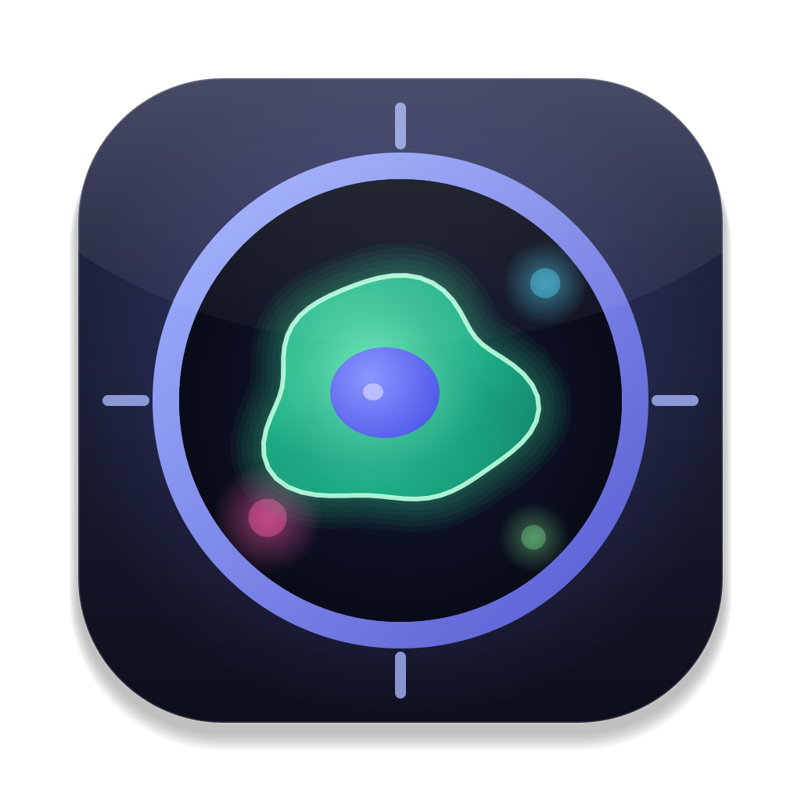
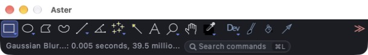
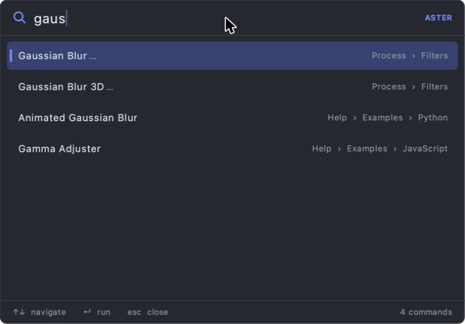

<p align="center">
  
</p>

<h1 align="center">Aster</h1>

<p align="center">
  A modern macOS interface for scientific image analysis — every ImageJ 1.x command, plugin and macro, with a cleaner face.
</p>

<p align="center">
  
</p>

> **Unofficial.** Aster is an independent interface fork of [ImageJ 1.x](https://github.com/imagej/ImageJ) (version 1.54u) by Wayne Rasband and the NIH. It is not affiliated with or endorsed by the NIH or the ImageJ developers.

The name comes from the *aster*, the star-shaped array of microtubules that forms around each centrosome during cell division.

## What's different

Aster changes only the user interface. The image-processing core (filters, measurements, file I/O, the macro language and plugin API) is untouched, so existing plugins, macros and workflows keep working.

- **Dark and light themes.** Aster follows macOS appearance by default; you can choose a theme under *Edit › Options › Aster Theme…*.
- **Flat toolbar.** Rounded buttons, an accent highlight for the active tool, and hover feedback. Legacy macro-tool icons are recoloured so they stay legible on dark backgrounds.
- **Command palette (⌘L).** Fuzzy search across every menu command, plugin and macro. Recently used commands appear first, and each result shows its menu path. Open it with ⌘L or the *Search commands* field in the status bar.
- **Refined details.** SF Pro typography, a slim status bar, a pill-shaped progress bar, and image windows whose background matches the theme.
- **Native Mac app.** A self-contained `.app` with its own Java runtime (no Java install needed), TIFF file associations and a new icon.

<p align="center">
  
</p>

## Install

1. Download the latest `Aster-x.y.z.dmg` from [Releases](../../releases).
2. Open the DMG and drag **Aster** into **Applications**.
3. The app is not notarized. On first launch, right-click Aster and choose **Open**.

Plugins and macros go in `~/Library/Application Support/Aster/plugins` and `.../macros`.

## Build from source

You need JDK 17 or newer, which provides `jpackage`, on macOS.

```bash
./build.sh
```

The script compiles the sources in `imagej-src/`, draws the app icon (`tools/IconGen.java`) and writes `Aster-<version>.dmg` to the repository root.

## Changed files

| File | Purpose |
|---|---|
| `ij/gui/StudioTheme.java` | Design tokens: palette, typography, theme detection |
| `ij/gui/Toolbar.java` | Flat, rounded tool buttons with hover state |
| `ij/gui/StudioSearchPill.java` | *Search commands* field in the status bar |
| `ij/plugin/CommandPalette.java` | ⌘L command palette |
| `ij/plugin/StudioThemeOptions.java` | *Edit › Options › Aster Theme…* |
| `ij/StudioLauncher.java` | App entry point and user folders |
| `ij/ImageJ.java`, `ij/gui/ImageWindow.java`, `ij/gui/ProgressBar.java` | Status bar, window and progress styling |
| `IJ_Props.txt` | Maps *Find Commands…* (⌘L) to the palette and adds the theme option |

## Known limitations

- Native dialogs use the light macOS appearance even with the dark theme. ImageJ's AWT dialogs hard-code light backgrounds, and their text becomes unreadable under the dark appearance.
- *Edit › Options › Memory & Threads* cannot edit the bundled app's settings. Aster uses up to 75% of system RAM by default.

## License

ImageJ 1.x is in the **public domain** (see [`imagej-src/LICENSE.txt`](imagej-src/LICENSE.txt)). Aster's own additions are also released into the public domain. Release DMGs bundle an OpenJDK runtime licensed under GPLv2 with the Classpath Exception; its license files are included inside the app bundle. See [NOTICE.md](NOTICE.md).
